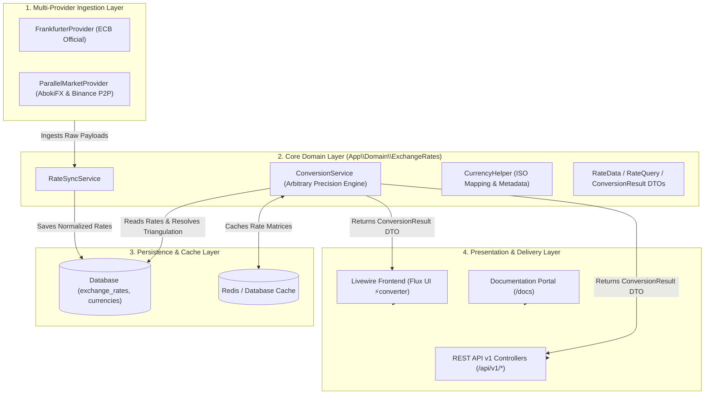
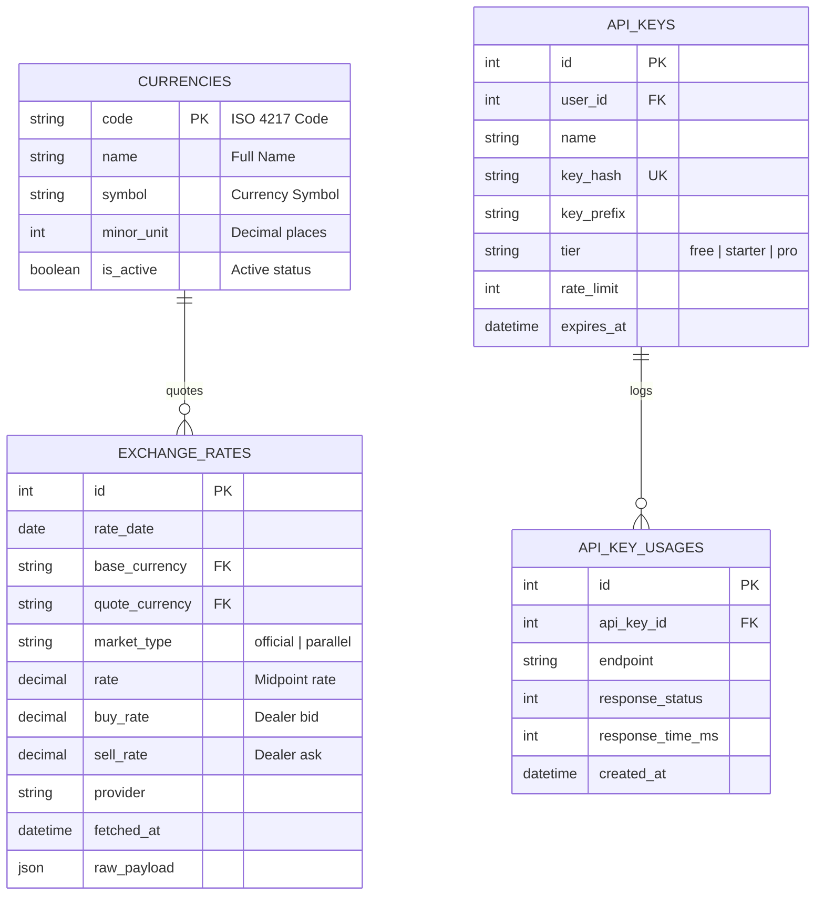

# LemonWaresEX ⚡

[](https://laravel.com)
[](https://php.net)
[](https://livewire.laravel.com)
[](https://fluxui.dev)
[](https://pestphp.com)

**LemonWaresEX** is an enterprise-grade, high-precision foreign exchange conversion platform and developer REST API. Built on Laravel 12, Livewire, and Brick Math arbitrary-precision decimal operations, it solves the real-world disconnect between official central bank rates and parallel street market cash realities (such as Nigeria's AbokiFX and global P2P liquidity order books).

---

## 📑 Table of Contents

1. [Key Features](#-key-features)
2. [System Architecture & Design](#-system-architecture--design)
3. [Mathematical Engine & Precision Model](#-mathematical-engine--precision-model)
4. [Multi-Market Ingestion Pipeline](#-multi-market-ingestion-pipeline)
5. [Bid / Ask Spread & Trade Intent Engine](#-bid--ask-spread--trade-intent-engine)
6. [API Reference & Schema](#-api-reference--schema)
7. [Database Schema & Models](#-database-schema--models)
8. [CLI Commands & Automation](#-cli-commands--automation)
9. [Installation & Local Setup](#-installation--local-setup)
10. [Test Suite & Quality Assurance](#-test-suite--quality-assurance)

---

## 🌟 Key Features

* **Zero Float Arithmetic Error**: Powered by `brick/math` (BigDecimal) calculating at 15 internal decimal places, eliminating standard IEEE 754 floating-point inaccuracies (e.g., `0.1 + 0.2 = 0.30000000000000004`).
* **Dual Market Engine**:
  * **🏛️ Official Central Bank**: European Central Bank (ECB) and official interbank rates via Frankfurter.
  * **⚡ Parallel / Street Market**: Real-time cash BDC rates (AbokiFX) and digital peer-to-peer liquidity (Binance P2P) for high-spread economies (NGN, ARS, GHS, KES, EGP, ZAR, VES, LBP).
* **Real-World Bid / Ask Spread**: Ingests both Bureau De Change **Buy (Bid)** and **Sell (Ask)** spreads, calculating conversions tailored to user trade intent (`mid`, `buy`, or `sell`).
* **Automated Cross-Rate Triangulation**: Dynamically computes cross-rates between non-base currency pairs across markets (e.g., $\text{EUR} \to \text{USD} \to \text{NGN}$).
* **Developer REST API Platform**: Metered endpoints, API Key authorization (`X-API-Key`), tiered rate limiting, and structured JSON responses.
* **Modern Flux UI Component System**: Built with Livewire 3 and Flux UI, featuring light/dark mode theming, Plus Jakarta Sans typography, JetBrains Mono tabular rates, and zero artificial visual bloat.

---

## 🏗️ System Architecture & Design

LemonWaresEX follows **Domain-Driven Design (DDD)** and the **Clean Architecture / Ports and Adapters (Hexagonal)** pattern:



### Directory Structure

```text
app/
├── Domain/
│   └── ExchangeRates/
│       ├── Contracts/
│       │   └── ExchangeRateProvider.php
│       ├── Data/
│       │   ├── ConversionResult.php
│       │   ├── CurrencyData.php
│       │   ├── RateData.php
│       │   └── RateQuery.php
│       ├── Exceptions/
│       │   ├── CurrencyNotFoundException.php
│       │   └── RateNotFoundException.php
│       ├── Services/
│       │   ├── ConversionService.php
│       │   └── RateSyncService.php
│       └── Support/
│           └── CurrencyHelper.php
├── Http/
│   ├── Controllers/Api/V1/
│   │   ├── ConvertController.php
│   │   ├── CurrencyController.php
│   │   └── RateController.php
│   └── Middleware/
│       └── AuthenticateApiKey.php
├── Infrastructure/
│   └── ExchangeRates/
│       ├── Frankfurter/
│       │   ├── FrankfurterMapper.php
│       │   └── FrankfurterProvider.php
│       └── Parallel/
│           └── ParallelMarketProvider.php
└── Models/
    ├── ApiKey.php
    ├── ApiKeyUsage.php
    ├── Currency.php
    ├── ExchangeRate.php
    └── RateSyncLog.php
```

---

## 🧮 Mathematical Engine & Precision Model

Financial systems must guarantee that conversions are deterministic, audit-compliant, and free from binary floating-point representation bugs.

### 1. Zero Floating-Point Conversion

Conversions use `Brick\Math\BigDecimal` scaled to the ISO 4217 minor unit of the target currency with `RoundingMode::HalfUp`:

$$M_{\text{out}} = \text{round}\left(M_{\text{in}} \times R_{\text{effective}}, \text{minor\_unit}\right)$$

* **EUR $\to$ USD** (minor unit 2): $\$100.00 \times 1.1598 = \$115.98$
* **USD $\to$ JPY** (minor unit 0): $\$100.00 \times 159.441283 = ¥15,944$
* **USD $\to$ BHD** (minor unit 3): $\$100.00 \times 0.376000 = \text{BHD } 37.600$

---

### 2. Triangular Cross-Rate Derivation

When a direct rate pair is not natively published (e.g. $A \to B$ where both are quoted against canonical base $C$):

$$\text{Rate}(A \to B) = \frac{\text{Rate}(C \to B)}{\text{Rate}(C \to A)}$$

#### Cross-Market Parallel Triangulation:
For currencies converting to emerging parallel markets using USD as the parallel liquidity bridge ($C = \text{USD}$):

$$\text{Rate}(A \to B \mid \text{Parallel}) = \text{Rate}(A \to \text{USD} \mid \text{Official}) \times \text{Rate}(\text{USD} \to B \mid \text{Parallel})$$

$$\text{Example: } \text{Rate}(\text{EUR} \to \text{NGN} \mid \text{Parallel}) = \underbrace{1.159800}_{EUR \to USD \text{ (Official)}} \times \underbrace{1404.000000}_{USD \to NGN \text{ (AbokiFX)}} = \mathbf{1628.359200 \text{ NGN/EUR}}$$

---

### 3. Bid-Ask Spread & Black Market Premium

$$\text{Dealer Spread} = \text{Rate}_{\text{sell}} - \text{Rate}_{\text{buy}}$$

$$\text{Spread Percentage (\%)} = \left( \frac{\text{Rate}_{\text{sell}} - \text{Rate}_{\text{buy}}}{\text{Rate}_{\text{buy}}} \right) \times 100$$

$$\text{Black Market Premium (\%)} = \left( \frac{\text{Rate}_{\text{parallel}} - \text{Rate}_{\text{official}}}{\text{Rate}_{\text{official}}} \right) \times 100$$

---

## 🌐 Multi-Market Ingestion Pipeline

| Market Mode | Primary Ingestion Source | Fallback / Validator | Covered Pairs |
| :--- | :--- | :--- | :--- |
| **`official`** | **Frankfurter API** (European Central Bank / Interbank) | Cached ECB Baseline | 30+ G10 & major global currencies |
| **`parallel` (NGN)** | **AbokiFX** (Real-time street BDC physical cash feed) | **Binance P2P** USDT/NGN Order Book | USD/NGN, EUR/NGN, GBP/NGN |
| **`parallel` (Global)** | **Binance P2P API** (Real-time Top-5 Merchant Order Book) | Benchmarked Order Medians | USD/ARS, USD/GHS, USD/KES, USD/EGP, USD/ZAR, USD/VES, USD/LBP |

---

## 💼 Bid / Ask Spread & Trade Intent Engine

Physical foreign exchange dealers (Bureau De Change / Aboki) maintain a buy/sell spread. LemonWaresEX supports three distinct trade modes:

1. **`mid` (Mid-Market Reference)**:
   * The mathematical midpoint between buy and sell. Used for reference calculations and market analytics.
2. **`sell` (User Selling Foreign Cash)**:
   * Applies the dealer's **Buy (Bid)** rate (what the dealer pays you when you hand over foreign currency).
3. **`buy` (User Buying Foreign Cash)**:
   * Applies the dealer's **Sell (Ask)** rate (what you pay the dealer in local currency to receive foreign currency).

---

## 🔌 API Reference & Schema

### Base URL
```http
https://your-domain.com/api/v1
```

### Authentication Header
```http
X-API-Key: rf_live_your_api_key_here
```

---

### 1. Monetary Conversion
```http
GET /api/v1/convert?from=USD&to=NGN&amount=100&market=parallel&action=sell
```

#### Query Parameters:
| Parameter | Type | Required | Default | Description |
| :--- | :--- | :--- | :--- | :--- |
| `from` | `string` | **Yes** | — | 3-letter ISO base currency (e.g. `USD`). |
| `to` | `string` | **Yes** | — | 3-letter ISO target currency (e.g. `NGN`). |
| `amount` | `number` | **Yes** | — | Monetary amount (> 0). |
| `market` | `string` | No | `official` | `official` or `parallel`. |
| `action` | `string` | No | `mid` | `mid`, `buy` (Ask), or `sell` (Bid). |
| `date` | `string` | No | today | Point-in-time date (`YYYY-MM-DD`). |

#### Response (200 OK):
```json
{
  "data": {
    "from": "USD",
    "to": "NGN",
    "amount": "100.00",
    "rate": "1398.000000",
    "inverse_rate": "0.000715",
    "result": "139800.00"
  },
  "meta": {
    "rate_date": "2026-08-20",
    "market_type": "parallel",
    "trade_action": "sell",
    "provider": "parallel_p2p",
    "official_rate": "1347.740989",
    "buy_rate": "1398.000000",
    "sell_rate": "1410.000000",
    "bid_ask_spread": "12.00 (0.86%)",
    "spread_percentage": "+3.73%",
    "is_derived": false,
    "is_stale": false,
    "age_days": 0,
    "fetched_at": "2026-08-20T03:41:00Z"
  }
}
```

---

### 2. Latest Rates Matrix
```http
GET /api/v1/rates/latest?base=USD&symbols=EUR,GBP,NGN&market=parallel
```

#### Response (200 OK):
```json
{
  "base": "USD",
  "date": "2026-08-20",
  "market": "parallel",
  "provider": "parallel_p2p",
  "rates": {
    "EUR": "0.862218",
    "GBP": "0.738101",
    "NGN": "1404.000000"
  }
}
```

---

### 3. Direct Currency Pair
```http
GET /api/v1/rates/USD/NGN?market=parallel
```

---

## 🗄️ Database Schema & Models



---

## ⌨️ CLI Commands & Scheduled Automation

LemonWaresEX includes automated background scheduler tasks registered in `routes/console.php`:

| Scheduled Task | Cadence | Purpose |
| :--- | :--- | :--- |
| `rates:sync-parallel` | **Every 30 Minutes** | Ingests real-time AbokiFX cash and Binance P2P black market spreads. |
| `rates:sync-latest` | **Every 3 Hours** (Weekdays) | Synchronizes official ECB / Frankfurter benchmark exchange rates. |
| `rates:sync-currencies` | **Daily at Midnight** | Synchronizes 165+ ISO currency records, names, symbols, and minor units. |

### Manual Execution & Worker Commands

```bash
# Sync real-time parallel / street / P2P rates
php artisan rates:sync-parallel

# Sync official central bank rates from Frankfurter
php artisan rates:sync-latest --base=EUR

# Sync full currency ISO definitions and minor units
php artisan rates:sync-currencies

# Backfill historical time-series rates
php artisan rates:backfill --from=2024-01-01 --to=2024-12-31

# Generate a new developer API key
php artisan api-key:generate "Mobile App Client" --tier=pro --rate-limit=1000

# Run the local continuous background scheduler worker
php artisan schedule:work

# Run scheduled cron synchronization in production
php artisan schedule:run
```

---

## 🚀 Installation & Local Setup

### Prerequisites
* **PHP 8.3+** with `bcmath`, `curl`, `sqlite3` / `pdo_sqlite` extensions
* **Composer 2+**
* **Node.js 18+** & **npm**

### Step-by-Step Setup

```bash
# 1. Clone the repository
git clone https://github.com/your-username/currencyConverter.git
cd currencyConverter

# 2. Install PHP & JavaScript dependencies
composer install
npm install

# 3. Environment configuration
cp .env.example .env
php artisan key:generate

# 4. Run database migrations
php artisan migrate

# 5. Ingest initial rate & currency datasets
php artisan rates:sync-currencies
php artisan rates:sync-latest
php artisan rates:sync-parallel

# 6. Start the unified development server (PHP + Vite)
composer run dev
```

Visit `http://localhost:8000` to access the application, or `http://localhost:8000/docs` to view the interactive API documentation.

---

## 🧪 Test Suite & Quality Assurance

LemonWaresEX is tested with **Pest PHP** across unit, feature, and integration tiers:

```bash
# Run the complete test suite
php artisan test --compact
```

### Covered Test Areas:
* ✅ **Unit/ConversionServiceTest**: High-precision math, ISO 4217 minor unit rounding, inverted rates, and cross-rate derivations.
* ✅ **Unit/ParallelRateConversionTest**: AbokiFX rate resolutions, Binance P2P order book medians, and black market spread calculations.
* ✅ **Feature/Api/V1/ConvertTest**: Parameter validation, HTTP 200 payload structures, and 404 error handling.
* ✅ **Feature/Api/V1/ParallelMarketApiTest**: API key authorization, rate limiting, and multi-market JSON meta verification.

---

## 📄 License
This project is open-sourced software licensed under the [MIT license](LICENSE).
